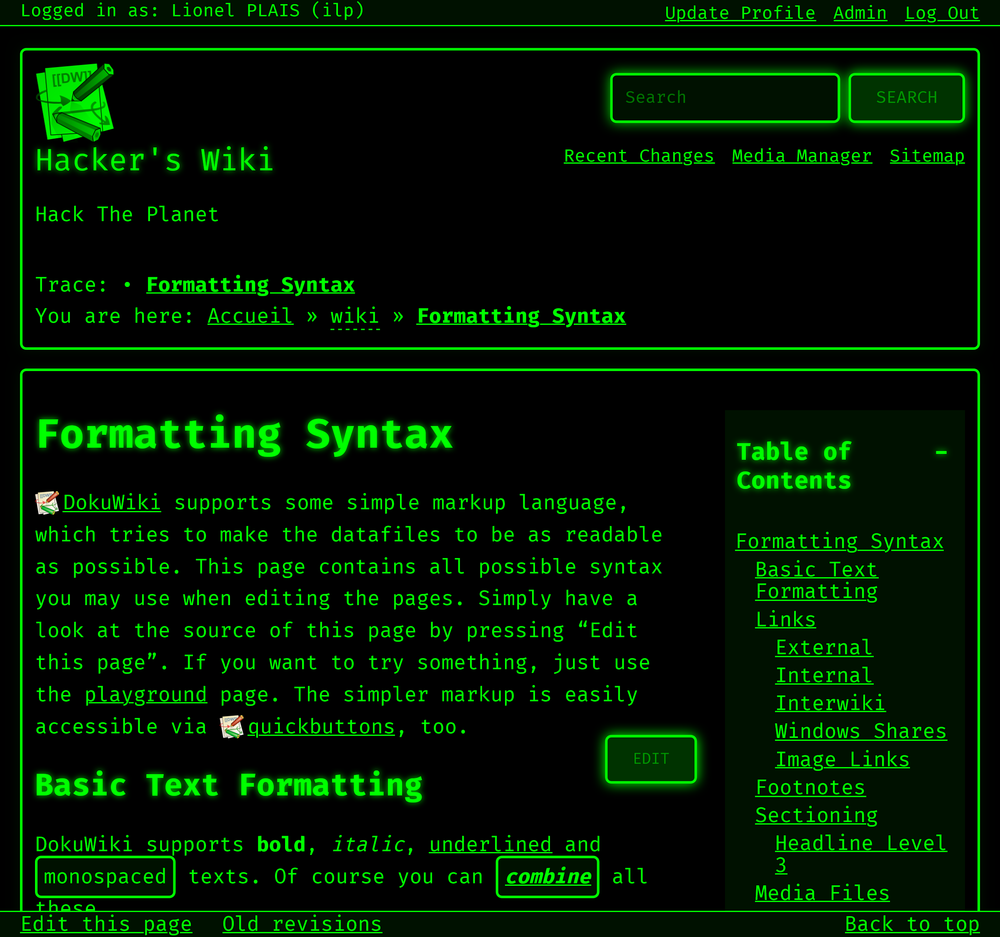

# Hacker Theme for DokuWiki

Minimalist terminal-style theme (green on black) for DokuWiki, preserving all features of the default theme.

This template can be found at https://www.dokuwiki.org/template:hacker.css

## Theme Files

- [`main.php`](main.php) — main template (pages, editing, search, etc.)
- [`detail.php`](detail.php) — image detail page
- [`mediamanager.php`](mediamanager.php) — media manager popup
- [`style.ini`](style.ini) — CSS loading and placeholders for plugins
- [`template.info.txt`](template.info.txt) — theme metadata
- [`css/hacker.css`](css/hacker.css) — main stylesheet
- [`assets/nerd-fonts/`](assets/nerd-fonts/) — CSS font files used by the template
- [`assets/nerd-fonts/fonts/`](assets/nerd-fonts/fonts/) — font cache directory (populated automatically)
- [`lang/`](lang/) — localization files used by the template

## Installation

### Via the Extensions Manager (easy)

The easiest way to install the template is:
1. Use the Extensions Manager in the admin panel;
2. Simply search for "hacker.css" and click "Install";
3. Then, go to the configuration page;
4. Select "hacker.css" from the template dropdown menu.

### Manually (less easy)

1. Copy the contents of this repository into `lib/tpl/hacker/` of your DokuWiki installation (the folder must be named `hacker`).
2. In DokuWiki: **Configuration Manager** → **Customization** → **Template** → select **Hacker**.
3. Save.

## Configuration

After selecting the template, you can customize it in the **Template/Hacker** section:

- **Main font** — choose a Nerd Font family

Fonts come from the [latest release of NerdFontsToWebFonts](https://github.com/ILPlais/NerdFontsToWebFonts/releases/latest). Browsers cannot load fonts from its archives, so the server extracts the files needed by the selected font on first use (~few MB per font), caches them and serves them itself. It checks for a new release once a day.

The server must be able to reach `github.com`, `api.github.com` and `release-assets.githubusercontent.com` over HTTPS, and the web server user must be able to write to `assets/nerd-fonts/fonts/`. Until the font is installed, the browser's default font is used.

## Screenshot

## Sources

### Hacker.css

The CSS template is from the [Hacker Style Library](https://github.com/webshahab-ir/hacker.css).

### Nerd Fonts

The [Nerd Fonts](https://www.nerdfonts.com/) for the Web are converted to WOFF2 by [NerdFontsToWebFonts](https://github.com/ILPlais/NerdFontsToWebFonts). The `@font-face` declarations in `assets/nerd-fonts/` are based on [Nerd Font Web Fonts](https://github.com/mshaugh/nerdfont-webfonts).
